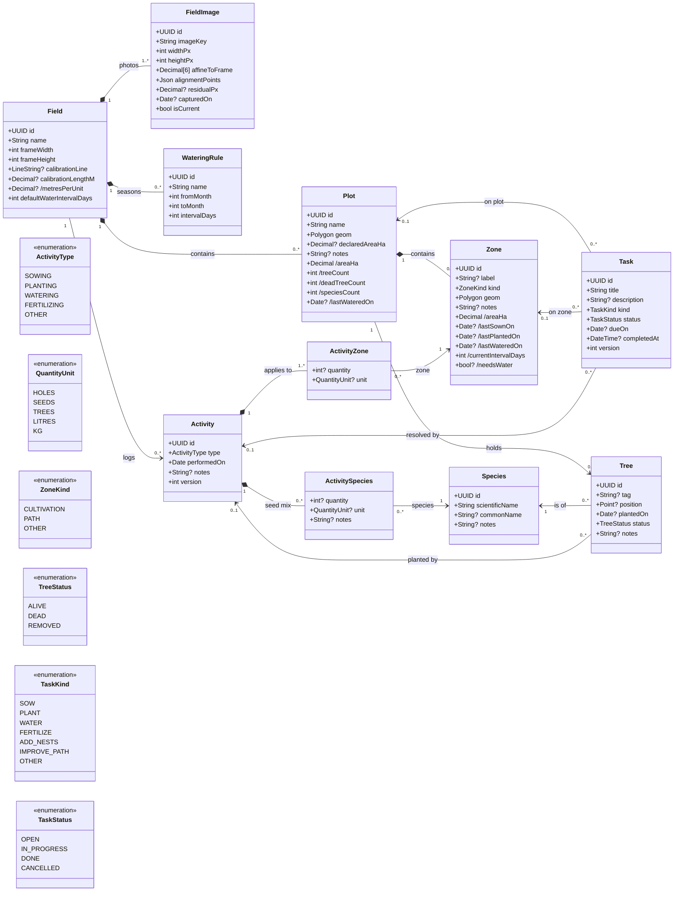
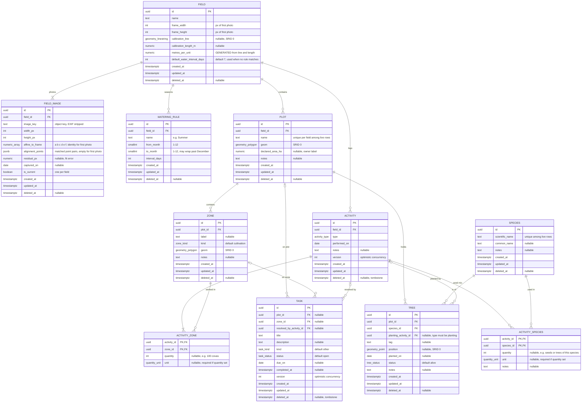

# Forest — Data Model

> Status: **draft v3** — owner answers from 2026-11-22 applied (section 6), review fixes applied. No code or migrations exist yet.

## 1. Overview

Forest replaces the hand-annotated Google Maps screenshot of a ~10 ha reforestation field. The core parts:

- **Field** is the satellite photo plus the coordinate frame drawn on it.
- **Plot** is a named area of the field (the green outlines, e.g. "PLOT 1 (6.2ha)").
- **Zone** is a smaller polygon inside a plot that the owner works on (the blue and red polygons).
- **Activity** records work done on one or more zones: sowing, planting, watering or fertilizing, with a date, a quantity (e.g. *covas*) and notes.
- **Task** is pending work attached to a plot or a zone ("Falta semear", "Melhorar caminho").
- **Tree** is an individual tree with a **Species**, an optional position and the planting it came from.
- **FieldImage** is one satellite photo of the field; newer photos are aligned to the first one.
- **WateringRule** says how often zones need water in a given season (month range).
- **ActivitySpecies** is the species / seed mix used in a sowing or planting.

A zone's state ("sown on 28 Sep", "needs water") is **derived from its activities**, not stored on the zone.

### Coordinate system (no real GPS, ever)

- Every uploaded photo has its EXIF data stripped. Nothing in the database can be mapped back to latitude/longitude.
- **Units = pixels of the *first* uploaded image** (the frame). The origin is the top-left corner, x points right and y points down. A point is `(x, y)` in those pixels. Coordinates are not normalised to 0–1, because a non-square image would then have different scales on the x and y axes.
- **Scale.** The owner draws a calibration line over something of known length (e.g. a 100 m path) and types in the length. The field stores the line and the length, and derives `metres_per_unit = length_m / line_length_units`.
- **Area.** `area_ha = ST_Area(geom) × metres_per_unit² / 10 000`. Before calibration, areas are shown as "uncalibrated".
- All geometries use PostGIS **SRID 0**, which is plain cartesian with no Earth model. The frontend draws on the image with the same pixel coordinates, so no projection is ever needed.
- **New photos keep the frame.** The *first* uploaded photo defines the frame. A newer photo is aligned to it by clicking ≥ 3 matching points (a rock, a path corner) on both images. That gives an affine transform (least-squares fit) stored on the `FieldImage` row, and the frontend uses it to draw the new photo under the existing shapes. Geometries are **always stored in frame units**: anything drawn or calibrated on a newer photo is converted to the frame before saving, so geometries never change when a photo is replaced. `frame_width`/`frame_height` are not bounds — a larger newer photo can yield negative or out-of-range coordinates, which is fine.

## 2. Domain model (UML)

Optional attributes are marked with `?`. Derived (computed, not stored) attributes are prefixed with `/`. Enum values are shown in UPPER case here; the PostgreSQL enum labels are lowercase (`cultivation`, `alive`, …).

A Task belongs to **exactly one** of Plot or Zone.

## 3. Physical schema (PostgreSQL + PostGIS)

All `geom` columns are `geometry(<Type>, 0)` with a GiST index and a `CHECK (ST_IsValid(geom))`. Ids are `uuid`, defaulting to `gen_random_uuid()` but **accepted from the client** so entries made offline keep their id when they sync (see *Offline-first logging* in §4). Every table has `created_at`, `updated_at` and `deleted_at` except the two join tables, which are replaced wholesale together with their activity. Enum columns are PostgreSQL `ENUM` types named as shown.

**Constraints and helpers:**

- `task`: `CHECK (num_nonnulls(plot_id, zone_id) = 1)` and `CHECK ((status IN ('done','cancelled')) = (completed_at IS NOT NULL))`.
- `activity_zone` and `activity_species`: `CHECK ((quantity IS NULL) = (unit IS NULL))`.
- `activity_species`: only allowed for activities of type sowing or planting (checked by the API).
- `activity_zone.unit` must fit the activity type (API): sowing holes/seeds, planting trees, watering litres, fertilizing kg/litres, other any — so totals like "covas sown" never silently miss entries.
- Every activity has ≥ 1 zone. A foreign key can't enforce that, so the API does (the activity and its join rows are written in one transaction).
- A zone must lie inside its plot: checked by the API with `ST_Within(zone.geom, ST_Buffer(plot.geom, 1))` (1 unit tolerance). The same check applies to `tree.position` vs its plot. Cross-table CHECKs aren't possible in PostgreSQL.
- Zones **may overlap** (e.g. re-sowing part of an old area); no exclusion constraint. Each zone belongs to exactly one plot, which is stored, not inferred from geometry.
- Unique names ignore soft-deleted rows: partial unique indexes `plot (field_id, lower(name)) WHERE deleted_at IS NULL` and `species (lower(scientific_name)) WHERE deleted_at IS NULL` (both case-insensitive).
- Geometry columns also `CHECK (ST_SRID(geom) = 0 AND NOT ST_IsEmpty(geom))` — `geometry(…, 0)` alone does not enforce SRID 0. The store writes `ST_SetSRID(ST_Force2D(ST_GeomFromGeoJSON($1)), 0)`.
- Numeric measurements have an upper bound (e.g. `< 100000`), which also rejects `NaN`/`Infinity`.
- `field`: `CHECK ((calibration_line IS NULL) = (calibration_length_m IS NULL))`, `CHECK (calibration_length_m > 0 AND ST_Length(calibration_line) > 0)`, `CHECK (default_water_interval_days > 0)`. `metres_per_unit` is `GENERATED ALWAYS AS (calibration_length_m / ST_Length(calibration_line)::numeric) STORED`.
- `field_image`: `affine_to_frame` is `float8[]`, checked to be 1-D, exactly 6 non-null finite numbers. The transform maps photo px → frame units: `x' = a·x + b·y + c`, `y' = d·x + e·y + f`. Newer photos need ≥ 3 non-collinear point pairs (≥ 4 recommended so `residual_px` means something). The *first* photo is the one with the identity transform. Partial unique index `(field_id) WHERE is_current AND deleted_at IS NULL`; switching photos clears the old flag before setting the new one in the same transaction.
- `watering_rule`: `CHECK (from_month BETWEEN 1 AND 12 AND to_month BETWEEN 1 AND 12 AND interval_days > 0)`. A rule matches month `m` when `CASE WHEN from_month <= to_month THEN m BETWEEN from_month AND to_month ELSE m >= from_month OR m <= to_month END` (so Nov–Feb wraps December). If several rules match, the narrowest month range wins; the API warns when rules overlap.
- View **`zone_status`**: one row per live zone, with `last_sown_on`, `last_planted_on`, `last_watered_on`, `current_interval_days`, `open_task_count` and `needs_water`.
  - `current_interval_days` = the matching `watering_rule` for today's month, else `field.default_water_interval_days`.
  - `needs_water` is NULL for zones whose kind isn't `cultivation`. Otherwise, with `last = GREATEST(last_watered_on, last_sown_on, last_planted_on)`: false when `last` is NULL (nothing there yet), else `CURRENT_DATE - last >= current_interval_days`.
  - "Today" is `field_today()` = `(now() AT TIME ZONE 'Europe/Lisbon')::date`, independent of any session's timezone. Rule ties break by narrowest range, then `created_at`, then `id` (the PWA uses the same order).
  - The PWA repeats this small calculation on cached data so the map stays right offline.
- `updated_at` only moves when a row really changes. On `activity` and `task` a trigger also bumps `version` on every real change (soft deletes included); the API never sets `version` itself.
- Views ignore everything soft-deleted (field, plot, zone, activity, task, species): a deleted zone's history stays in the tables but no longer feeds plot numbers.
- View **`plot_stats`**: `area_ha`, `tree_count` (alive), `dead_tree_count`, `species_count`, `last_watered_on` and `open_task_count` (the plot's own tasks plus its zones' tasks). `species_count` = distinct species across alive trees in the plot ∪ species in sowing/planting `activity_species` rows whose activity touches the plot's zones.
- Overlap side effects: watering zone A does not mark an overlapping zone B as watered; a point can be in several zones (Q8 may return several); summed zone areas can double-count — plot areas always use the plot polygon.
- Indexes:
  - `activity (field_id, type, performed_on DESC)`
  - `activity_zone (zone_id)`, `activity_species (species_id)`
  - `tree (plot_id, species_id)`, `tree (planting_activity_id)`
  - `task (status)`, `task (plot_id)`, `task (zone_id)`
  - GiST on every `geom`/`position`
- Foreign keys use `ON DELETE RESTRICT`, because rows are soft-deleted rather than removed. The exceptions, used only when purging old tombstones: `activity_zone` and `activity_species` cascade from `activity`; `tree.planting_activity_id` and `task.resolved_by_activity_id` are set to `NULL`.
- One field for now, so nothing checks that an activity's zones belong to `activity.field_id`; add that check in the API when multiple fields arrive.

## 4. Design decisions

**Geometry in PostGIS, SRID 0 (rejected: JSONB polygon arrays).** The core questions are spatial: polygon area, "which zone is this tree in", and "is this zone inside its plot". PostGIS answers them in SQL with `ST_Area`, `ST_Contains` and `ST_Within`. It also adds validity checks and GiST indexes, and returns GeoJSON for the frontend via `ST_AsGeoJSON`. SRID 0 means plain cartesian maths, so no real-world reference can sneak in. JSONB would mean reimplementing point-in-polygon and area in Go, and it can't be indexed or validated. The only cost is switching the Postgres Docker image to `postgis/postgis`.

**Image-pixel coordinates plus a calibration line (rejected: normalised 0–1 coordinates).** Pixel units are isotropic: one unit is the same distance on both axes. That keeps `ST_Area × scale²` correct. Normalised 0–1 coordinates on a non-square image would stretch one axis. Storing the calibration line instead of a bare number lets the owner see and redo it, and `metres_per_unit` is a generated column, so it can't drift from the line.

**One `activity` table with a `type` enum (rejected: separate `sowing` / `planting` / `watering` tables).** All activity types share the same shape: a date, the zones, a quantity and notes. Timelines like "what happened in zone Z" and "last activity of any kind" become a single query rather than a `UNION`. Separate tables would only pay off if each type had several unique fields. A future type-specific field can go in a nullable column or a side table.

**A multi-zone log is one Activity row plus the `activity_zone` join table (rejected: N copied rows).** "Watered zones A, B and C today" is one real event. Edit or delete it once and every zone stays consistent. N rows would duplicate the date and notes and drift apart when edited. The **quantity lives on the join row**, so "100 covas" belongs to the zone where they were dug. That keeps per-zone and per-plot sums exact, even when one activity spans zones in different plots. A quick multi-zone watering simply leaves the quantity empty.

**Zone state is derived; only `kind` is stored (rejected: a stored `status` column).** "Sown", "planted", "needs water" and "last watered" all follow from the activity log. Computing them in the `zone_status` view means they can never go stale. Storing them would need triggers or app code to keep them in sync, and a single missed update would silently show the wrong state. `kind` (cultivation / path / other) is stored because it is intent: a path zone ("Melhorar caminho") never needs watering, and no activity can tell you that.

**A Task belongs to a plot *or* a zone, enforced by CHECK (rejected: a polymorphic `target_type` + `target_id`).** Two nullable foreign keys plus `num_nonnulls(...) = 1` keeps real referential integrity. A red polygon on the screenshot becomes a Zone (often of kind `path`/`other`) with a Task on it. `resolved_by_activity_id` lets the UI suggest closing an open "Falta semear" task when a sowing is logged in that zone.

**Tree: `plot_id` required, `position` optional, zone derived — except for counted trees (rejected: always a stored `zone_id`).** Every tree is known to be in some plot, which keeps per-plot stats a cheap `GROUP BY`. If a tree has a position, its zone comes from `ST_Contains(zone.geom, tree.position)`. If it doesn't, the zone is inferred from its planting activity's zones. Storing `zone_id` as well would give two sources of truth that disagree whenever a zone is redrawn. The app checks that `planting_activity_id` points to an activity of type `planting`. `planted_on` covers trees that predate the app and have no activity.

*Update (migration 00012):* trees recorded as counts on a zone ("12 alive, 2 dead sobreiros here") have no measured position, so their zone is stored in `tree.zone_id` (and `position` stays NULL). A made-up point would put them in every overlapping zone. Trees with a real position keep `zone_id` NULL and their zone is still derived. Counts are set as targets (idempotent for the offline queue); deleting a zone or plot retires its counted trees.

**Soft delete everywhere (rejected: hard delete for activities and tasks).** Referenced entities (`plot`, `zone`, `species`, `tree`, …) must survive so history stays intact: removing a zone must not erase what was sown there. Activities and tasks are soft-deleted too, because offline sync needs **tombstones**: if a delete reaches the server before a late, queued create or edit of the same id, the tombstone makes the server reject it instead of resurrecting the entry. Tombstones older than a few months can be purged.

**Seasonal watering rules (rejected: one fixed interval).** Summer needs watering far more often than winter. A small `watering_rule` table (month range → interval) per field keeps the rule data, not code, and the view picks the one in effect today. A per-zone override can be added later as a nullable column on `zone` if newly sown areas need it.

**Species on sowings via `activity_species` (rejected: species only on trees).** Sowing puts seeds into covas long before there are individual trees, so the seed mix ("sobreiro + medronheiro") is recorded on the activity. Planting uses the same table for the species split, and individual `tree` rows stay optional.

**Photo history with an alignment transform (rejected: one image per field).** All geometry lives in the frame of the first photo. Each newer photo stores a 6-number affine transform to that frame, fitted by least squares from ≥ 3 matched points, plus the points themselves and the fit error — like the calibration line, the owner can see and redo the alignment. Drawings carry over unchanged and old photos stay available for comparison.

**Offline-first logging (rejected: online-only).** The frontend queues changes in the browser (IndexedDB) while there is no signal and replays them in order when it's back. The rules:
- Ids are generated on the device. A create is an **upsert by id**: the same id with the same content is a no-op (safe retry); different content goes through the update path.
- Each queue item is a whole aggregate — an activity together with its `activity_zone` and `activity_species` rows — applied in one transaction.
- Queue order is kept, so a zone or species created offline is synced before the activity that uses it.
- Edits carry the `version` they were based on (optimistic concurrency). If the server's version moved on, the server rejects the edit and the app shows both versions to pick from. With one person using the app this should be rare.
- Deletes leave tombstones (see *Soft delete everywhere*), and a create or edit for a tombstoned id is rejected.

**Users later, not now (rejected: modelling auth today).** Every table chains up to `field`, either directly or through `plot`/`activity`. Multi-user support later is therefore one `app_user` table plus `field.owner_id` (or a `field_member` table), with each query scoped by field. `species` is a global catalogue for now and could gain a nullable `owner_id` later. Adding `created_by` columns at that point is a non-breaking migration.

## 5. Questions the model must answer

| # | Question (plain words) | Supported? | How |
|---|---|---|---|
| 1 | Zones in Plot 1 not watered in the last 7 days | Yes | `zone_status` filtered by plot; `last_watered_on` is null or older than 7 days |
| 2 | Trees per species in a plot | Yes | `tree` grouped by `species_id` for one `plot_id` (status alive) |
| 3 | Plot area in hectares, and how it compares with the "6.2 ha" label | Yes | `ST_Area(plot.geom) × scale²` vs `declared_area_ha` |
| 4 | Per-plot stats: area, tree count, dead trees, species diversity, last watered | Yes | `plot_stats` view |
| 5 | Total covas sown in Plot 1 during September | Yes | Sum of `activity_zone.quantity` (unit holes) for sowing activities in that date range and in zones of that plot |
| 6 | Everything that happened in a zone, newest first | Yes | `activity_zone` → `activity` ordered by `performed_on` |
| 7 | Open tasks for Plot 1, including tasks on its zones, by due date | Yes | `task` where `plot_id` = P or `zone.plot_id` = P, status open/in progress |
| 8 | Which zone(s) a given tree stands in | Yes | Counted trees store their zone (`tree.zone_id`, migration 00012); a tree with a measured position: `ST_Contains` (may be several, zones overlap) |
| 9 | Trees that came from the 28 Sep planting | Model only | `tree.planting_activity_id`; the app counts trees per zone and species and does not link counts to a planting yet |
| 10 | Zones that have never been sown | Yes | Zones of kind cultivation with no sowing activity |
| 11 | Parts of a plot not covered by any zone yet | Yes | `ST_Difference(plot.geom, COALESCE(ST_Union(zone.geom), 'POLYGON EMPTY'::geometry))` over live zones |
| 12 | Zones that need water right now (field-wide) | Yes | `zone_status.needs_water` (already false/NULL for non-cultivation zones) |
| 13 | Which species were sown in zone Z | Yes | `activity_species` of sowing activities linked to Z via `activity_zone` |
| 14 | Dead trees per plot | Yes | `plot_stats.dead_tree_count` (no date of death — decision 5) |
| 15 | Watering interval in effect today | Yes | `zone_status.current_interval_days` |

## 6. Owner decisions (2026-11-22)

1. **Watering is logged per zone**, several zones at once (one activity + `activity_zone`).
2. **"Needs water" varies by season** → `watering_rule` table.
3. **Zones can overlap**; each still belongs to one plot.
4. **Sowings record species / seed mix** → `activity_species`.
5. **Tree lifecycle: counting dead is enough** → `tree.status` (alive / dead / removed), no replacement tracking.
6. **New photos carry existing drawings over** → `field_image` with an alignment transform.
7. **Logging works offline** → client-generated UUIDs, upsert-by-id creates, `version` for conflicts, tombstones; the frontend is a PWA with a local sync queue.
